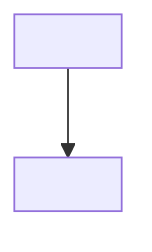

# ALIGN.md template

Use this layout to present the plan and to save `ALIGN.md`.

## Forms

Size the plan to the task. Show a section only when it tells the reader something the other sections do not.

- Light: use for a simple task. That means one or two work todos, no UI, no one-way door beyond the approved delivery, and an approach the end state makes clear. Show End state, Goal, Decisions when any exist, Todos, and Summary. Fold success criteria into each todo's `Done when`, put a short file tree in the End state when files change, list files in each todo's `Files`, put all delivery in one todo, and list human checkpoints only when there are any.
- Full: use for everything else. Show every section.
- Both forms show the End state first, the Intention under Goal, and the Don'ts section. Write `none` for a kind of Don't that does not apply.
- When unsure, use full. Switch to full when revision grows the task past light.
- A light plan may add any full section that helps, such as a Mermaid walkthrough when the short end state does not make the flow clear.

## Rules

- Put the End state section first in both forms, before Goal. The light End state is one short section.
- Number only success criteria and todos, as `##` headings with `1 ·` or `1a ·`, never `1.`. Sections and End state views get no number.
- Give each End state view its own `##` heading. Never use `###`. The light End state has no view headings.
- Show End state behavior in Mermaid only, never code or pseudo code.
- End state items are the success criteria. In the light form they are the `Done when` lines. Each names its proof, the observable check that shows it is met.
- Start each success criterion with an action verb.
- Mark each decision `two-way` or `one-way`. Mark each todo with `Door`. A two-way door is reversible: decide it and report the choice afterward. A one-way door is irreversible: record approved exact values, or the preference that allows it.
- Mark each todo `(subagent)` or `(main agent)`. Use main agent for todos that need tools, grants, or a screen that subagents lack.
- Keep the Intention to one line on why the user wants the result. When the end state proves impossible or contradictory, use it to recommend a re-align, never to change the end state alone.
- Start each Don't with `Out of scope:` for what this task does not build, or `Must not happen:` for a result to avoid even within scope.
- Write everything else as normal text.
- Quote Mermaid labels that contain punctuation and check each diagram parses before presenting.
- Number and letter todos only as a reading aid. `Depends on` drives scheduling.
- Give todos that could share a file or stateful resource a dependency so they never run at once.
- Cover both directions. Every end state item is met by the end state, built by a todo, and proven by its named check. Every todo serves an end state item. Revise the plan when either direction has a gap. In the light form, every `Done when` line proves the end state.

## Full form

````markdown
# ALIGN: <title>

Version: <n> · Status: draft | approved by <who> on <date>

# End state

## <Flow name>



## Prototype

<Throwaway HTML prototype, only if UI is involved.>

## File tree

```text
<path>    # NEW | MODIFIED | DELETED: <why>
```

---

# Goal

<Request restated. Before → after when replacing something.>

Intention: <why the user wants this, in one line>

---

# Don'ts

- Out of scope: <what this task does not build>
- Must not happen: <a result to avoid even within scope, such as a regression>

---

# Decisions

1. <Settled decision> · two-way | one-way · <approved exact values, or allowed by preferences>

---

# Success criteria

## 1 · <Action verb and outcome>

- Met by: <todos>
- Proven by: <observable check>

---

# Human checkpoints

1. <Point>: cleared (<how>) | approved (<exact values>)

---

# Todos

## 2a · <title>        (subagent)
- Door: two-way | one-way · <approved exact values, or allowed by preferences>
- Depends on: 1a
- Serves: end state items 3, 5
- Goal: what is true when it's done
- Files: exact paths to create, modify, or delete
- How: numbered concrete steps
- Done when: observable checks

---

# Summary

- What: <outcome>
- Size: <todos, files, or time>
- Key choices: <decisions that shape the result>
- When you are needed: <checkpoints left, or none>
- Approval authorizes: <every action, including one-way values>
````

## Light form

````markdown
# ALIGN: <title>

Version: <n> · Status: draft | approved by <who> on <date>

# End state

<Observable result.>

```text
<path>    # NEW | MODIFIED | DELETED: <why, when files change>
```

---

# Goal

<Request restated. Before → after when replacing something.>

Intention: <why the user wants this, in one line>

---

# Don'ts

- Out of scope: <what this task does not build>
- Must not happen: <a result to avoid even within scope, such as a regression>

---

# Todos

## 1 · <title>        (subagent)
- Door: two-way | one-way · <approved exact values, or allowed by preferences>
- Goal: what is true when it's done
- Files: exact paths to create, modify, or delete
- How: numbered concrete steps
- Done when: observable checks that prove the end state

## 2 · Deliver        (subagent)
- Door: one-way · approved: <branch, base, commit message, PR title, and body>
- Depends on: 1
- How: commit `<message>` on `<branch>`, push, open PR `<title>` against `<base>` with <description> and <reviewers>, then Moniterate
- Done when: <PR is open and checks pass>

---

# Summary

- What: <outcome>
- When you are needed: <checkpoints left, or none>
- Approval authorizes: <every action, including one-way values>
````
