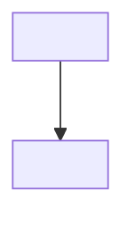

# ALIGN.md template

Use this layout to present the plan and to save `ALIGN.md`.

- Number each success criterion and todo as a `##` heading with `1 ·` or `1a ·`, never `1.`.
- Give each End state view its own `##` heading. Never use `###`.
- Show End state behavior in Mermaid only, never code or pseudo code.
- Start each success criterion with an action verb.
- Mark each todo `(subagent)` or `(main agent)`. Use main agent for todos that need tools, grants, or a screen that subagents lack.
- Write everything else as normal text.
- Quote Mermaid labels that contain punctuation and check each diagram parses before presenting.
- Number and letter todos only as a reading aid. `Depends on` drives scheduling.
- Give todos that could share a file or stateful resource a dependency so they never run at once.
- Cover both directions. Every criterion is met by the end state, built by a todo, and proven by a done-when check. Every todo serves a criterion. Revise the plan when either direction has a gap.

````markdown
# ALIGN: <title>

Version: <n> · Status: draft | approved by <who> on <date>

# 1 · Goal

<Request restated. Before → after when replacing something.>

---

# 2 · Decisions

1. <Settled decision>

---

# 3 · End state

## 1 · <Flow name>



## 2 · Prototype

<Throwaway HTML prototype, only if UI is involved.>

## 3 · File tree

```text
<path>    # NEW | MODIFIED | DELETED: <why>
```

---

# 4 · Success criteria

## 1 · <Action verb and outcome>

- Met by: <todos>
- Proven by: <observable check>

---

# 5 · Human checkpoints

1. <Point>: cleared (<how>) | approved (<exact values>)

---

# 6 · Todos

## 2a · <title>        (subagent)
- Door: two-way | one-way · approved: <exact values>
- Depends on: 1a
- Serves: criteria 3, 5
- Goal: what is true when it's done
- Files: exact paths to create, modify, or delete
- How: numbered concrete steps
- Done when: observable checks

---

# 7 · Summary

- What: <outcome>
- Size: <todos, files, or time>
- Key choices: <decisions that shape the result>
- When you are needed: <checkpoints left, or none>
- Approval authorizes: <every action, including one-way values>
````
