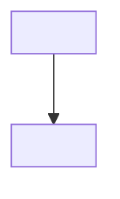

# ALIGN.md template

Use this layout to present the plan and to save `ALIGN.md`.

## Forms

Size the plan to the task. Show a section only when it tells the reader something the other sections do not.

- Light: use for a simple task. That means one or two work todos, no UI, no one-way door beyond the approved delivery, and an approach the end state items make clear. Show End state, Criteria, Todos, Stack when delivering a PR, Goal, Don'ts, Decisions when any exist, and Summary. Add Flow only when the items do not make the flow clear. Add a file tree when files change. Put all delivery in one todo and one Stack entry. List human checkpoints only when there are any.
- Full: use for everything else. Show every section.
- Both forms open with the End state items, then Criteria. Both show the Intention under Goal and the Don'ts section. Write `none` for a kind of Don't that does not apply.
- When unsure, use full. Switch to full when revision grows the task past light.
- When a section is shown, keep this order: End state, Criteria, Flow, File tree, Todos, Stack, Goal, Don'ts, Decisions, Human checkpoints, Summary. The title and status lines stay above End state.

## Rules

- The first section is End state. Each item is one observable outcome under its own `##` heading.
- Each item names one proof, and that proof is a command, a test, a screenshot, or a URL. Write the command or test to run, the screenshot to compare, or the URL to open, and the result that passes.
- Criteria follow the items. Start each criterion with an action verb and name the end state item that proves it.
- Flow is a Mermaid walkthrough of the behavior, never code or pseudo code. Put a throwaway HTML prototype in Flow only when UI is involved.
- The file tree comments why each file is created, modified, or deleted.
- Number end state items, criteria, and todos as `##` headings with `1 ·` or `1a ·`, never `1.`. Other sections get no number. Never use `###`.
- Mark each decision `two-way` or `one-way`. Mark each todo with `Door`. A two-way door is reversible: decide it and report the choice. Do not ask. A one-way door is irreversible: ask unless a preference already allows it, then record the approved exact values or the preference.
- Mark each todo `(subagent)` or `(main agent)`. Use main agent for todos that need tools, grants, or a screen that subagents lack.
- Keep the Intention to one line on why the user wants the result. When the end state proves impossible or contradictory, use it to recommend a re-align, never to change the end state alone.
- Start each Don't with `Out of scope:` for what this task does not build, or `Must not happen:` for a result to avoid even within scope.
- Write everything else as normal text.
- Quote Mermaid labels that contain punctuation and check each diagram parses before presenting.
- Number and letter todos only as a reading aid. `Depends on` drives scheduling.
- Fan out independent todos. Fix shared paths, names, and interfaces in the plan first. Give todos that could share a file or stateful resource a dependency so they never run at once.
- The Stack section is the PR plan per the `pr` skill. List each PR's branch, base, title, commits, body, and reviewers. The bottom PR targets the approved base. Each later PR is based on the previous PR's branch. A delivery todo carries out the Stack entry it names.
- On approval, run `criteria-hash <ALIGN.md>` from the `task-recording` skill folder for either form, and write `Criteria hash: <digest>` outside the hashed section. Leave it blank until approval. Then copy the saved file to `ALIGN.approved.md`. Replace that copy only on a later approval.
- Cover both directions. Every end state item has one proof, is named by a criterion, and is built by a todo. Every criterion names an end state item. Every todo serves an end state item. Revise the plan when any direction has a gap.

## Full form

````markdown
# ALIGN: <title>

Version: <n> · Status: draft | approved by <who> on <date>
Criteria hash: <digest>

# End state

## 1 · <observable outcome>

- Proof: command `<command and the result that passes>` | test `<test and the result that passes>` | screenshot <what the image must show> | URL <url and what it must show>

---

# Criteria

## 1 · <Action verb and outcome>

- Met by: <todos>
- Item: 1

---

# Flow



<Throwaway HTML prototype, only if UI is involved.>

---

# File tree

```text
<path>    # NEW | MODIFIED | DELETED: <why>
```

---

# Todos

## 2a · <title>        (subagent)
- Door: two-way | one-way · <approved exact values, or allowed by preferences>
- Depends on: 1a
- Serves: end state item 1
- Goal: what is true when it's done
- Files: exact paths to create, modify, or delete
- How: numbered concrete steps
- Done when: the proof of end state item 1

## 3 · Deliver        (subagent)
- Door: one-way · approved: the Stack
- Depends on: 2a
- Serves: end state item 1
- Goal: the Stack is open
- How: deliver each Stack entry per the `commit` and `pr` skills, then Moniterate
- Done when: each PR is open against its base

---

# Stack

`<branch>` → `<base>` · <title>
- Commits: `<message>`
- Body: <why and how>
- Reviewers: <names>
- Later fixes: <how they land on this PR>

`<branch>` → `<previous branch>` · <title>
- Stacked on the PR above.
- Commits: `<message>`
- Body: <why and how>
- Reviewers: <names>
- Later fixes: <how they land on this PR>

---

# Goal

<Request restated. Before → after when replacing something.>

Intention: <why the user wants this, in one line>

---

# Don'ts

- Out of scope: <what this task does not build>
- Must not happen: <a result to avoid even within scope, such as a regression>

---

# Decisions

1. <Reported or approved decision> · two-way | one-way · <reported choice, approved exact values, or allowed by preferences>

---

# Human checkpoints

1. <Point>: cleared (<how>) | approved (<exact values>)

---

# Summary

- What: <outcome>
- Size: <todos, files, or time>
- Key choices: <decisions that shape the result>
- When you are needed: <checkpoints left, or none>
- Approval authorizes: <every action, including reported two-way choices and one-way values>
````

## Light form

````markdown
# ALIGN: <title>

Version: <n> · Status: draft | approved by <who> on <date>
Criteria hash: <digest>

# End state

## 1 · <observable outcome>

- Proof: command `<command and the result that passes>` | test `<test and the result that passes>` | screenshot <what the image must show> | URL <url and what it must show>

---

# Criteria

## 1 · <Action verb and outcome>

- Met by: 2
- Item: 1

---

# File tree

```text
<path>    # NEW | MODIFIED | DELETED: <why, when files change>
```

---

# Todos

## 2 · <title>        (subagent)
- Door: two-way | one-way · <approved exact values, or allowed by preferences>
- Serves: end state item 1
- Goal: what is true when it's done
- Files: exact paths to create, modify, or delete
- How: numbered concrete steps
- Done when: the proof of end state item 1

## 3 · Deliver        (subagent)
- Door: one-way · approved: the Stack
- Depends on: 2
- Serves: end state item 1
- How: deliver the Stack, then Moniterate
- Done when: the PR is open against its base

---

# Stack

`<branch>` → `<base>` · <title>
- Commits: `<message>`
- Body: <why and how>
- Reviewers: <names>
- Later fixes: <how they land on this PR>

---

# Goal

<Request restated. Before → after when replacing something.>

Intention: <why the user wants this, in one line>

---

# Don'ts

- Out of scope: <what this task does not build>
- Must not happen: <a result to avoid even within scope, such as a regression>

---

# Summary

- What: <outcome>
- When you are needed: <checkpoints left, or none>
- Approval authorizes: <every action, including reported two-way choices and one-way values>
````
