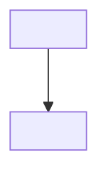

# ALIGN.md template

Use this layout to present the plan and to save `ALIGN.md`.

## Forms

Size the plan to the task. Show a section only when it tells the reader something the other sections do not.

- Light: use for a simple task. That means one or two work todos, no UI, no irreversible action beyond the approved delivery, and an approach the Goal makes clear. Show Goal, Decisions when any exist, Todos, and Summary. Fold success criteria into each todo's `Done when`, list files in each todo's `Files`, put all delivery in one todo, and list human checkpoints only when there are any.
- Full: use for everything else. Show every section.
- Both forms show the Intention under Goal and the Don'ts section. Write `none` for a kind of Don't that does not apply.
- When unsure, use full. Switch to full when revision grows the task past light.
- A light plan may add any full section that helps, such as a Mermaid diagram for a flow the Goal does not make clear.

## Rules

- Number only success criteria and todos, as `##` headings with `1 ·` or `1a ·`, never `1.`. Sections and End state views get no number.
- Give each End state view its own `##` heading. Never use `###`.
- Show End state behavior in Mermaid only, never code or pseudo code.
- Start each success criterion with an action verb.
- Mark each todo `(subagent)` or `(main agent)`. Use main agent for todos that need tools, grants, or a screen that subagents lack.
- Keep the Intention to one line on why the user wants the result. When the end state proves impossible or contradictory, use it to recommend a re-align, never to change the end state alone.
- Start each Don't with `Out of scope:` for what this task does not build, or `Must not happen:` for a result to avoid even within scope.
- Write everything else as normal text.
- Quote Mermaid labels that contain punctuation and check each diagram parses before presenting.
- Number and letter todos only as a reading aid. `Depends on` drives scheduling.
- Give todos that could share a file or stateful resource a dependency so they never run at once.
- Cover both directions. Every criterion is met by the end state, built by a todo, and proven by a done-when check. Every todo serves a criterion. Revise the plan when either direction has a gap. In the light form, every todo's `Done when` proves the Goal.

## Full form

````markdown
# ALIGN: <title>

Version: <n> · Status: draft | approved by <who> on <date>

# Goal

<Request restated. Before → after when replacing something.>

Intention: <why the user wants this, in one line>

---

# Don'ts

- Out of scope: <what this task does not build>
- Must not happen: <a result to avoid even within scope, such as a regression>

---

# Decisions

1. <Settled decision>

---

# End state

## <Flow name>



## Prototype

<Throwaway HTML prototype, only if UI is involved.>

## File tree

```text
<path>    # NEW | MODIFIED | DELETED: <why>
```

---

# Success criteria

## 1 · <Action verb and outcome>

- Met by: <todos>
- Proven by: <observable check>

---

# Human checkpoints

1. <Point>: cleared (<how>) | approved (<exact values>)

---

# Todos

## 2a · <title>        (subagent)
- Approved values: <exact values, only for an irreversible action>
- Depends on: 1a
- Serves: criteria 3, 5
- Goal: what is true when it's done
- Files: exact paths to create, modify, or delete
- How: numbered concrete steps
- Done when: observable checks

---

# Summary

- What: <outcome>
- Size: <todos, files, or time>
- Key choices: <decisions that shape the result>
- When you are needed: <checkpoints left, or none>
- Approval authorizes: <every action, including the exact values of irreversible ones>
````

## Light form

````markdown
# ALIGN: <title>

Version: <n> · Status: draft | approved by <who> on <date>

# Goal

<Request restated. Before → after when replacing something.>

Intention: <why the user wants this, in one line>

---

# Don'ts

- Out of scope: <what this task does not build>
- Must not happen: <a result to avoid even within scope, such as a regression>

---

# Todos

## 1 · <title>        (subagent)
- Goal: what is true when it's done
- Files: exact paths to create, modify, or delete
- How: numbered concrete steps
- Done when: observable checks that prove the Goal

## 2 · Deliver        (subagent)
- Depends on: 1
- How: commit `<message>` on `<branch>`, push, open PR `<title>` against `<base>` with <description> and <reviewers>, then Moniterate
- Done when: <PR is open and checks pass>

---

# Summary

- What: <outcome>
- When you are needed: <checkpoints left, or none>
- Approval authorizes: <every action, including the exact values of irreversible ones>
````
