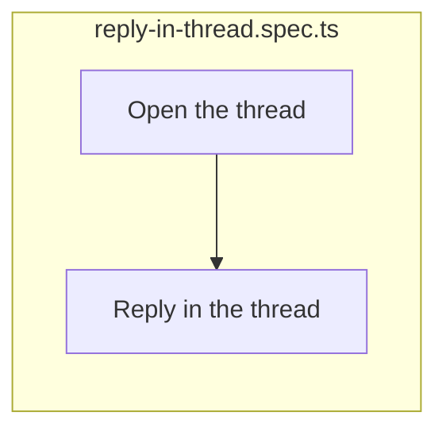

# ALIGN.md template

Use this layout to present the plan and to save `ALIGN.md`.

## Forms

Size the plan to the task. Show a section only when it tells the reader something the other sections do not.

- Light: use for a simple task. That means one or two work todos, no UI, no one-way door beyond the approved delivery, and an approach the end state items make clear. Show End state, Criteria, Todos, Stack when delivering a PR, Goal, Don'ts, Later and Decisions when any exist, and Summary. Add Files when files change. Put all delivery in one todo and one Stack entry. List human checkpoints only when there are any.
- Full: use for everything else. Show every section.
- Both forms open with the End state items, then the E2E workflow diagram, then Criteria. Both show the Intention under Goal and the Don'ts section. Write `none` for a kind of Don't that does not apply.
- When unsure, use full. Switch to full when revision grows the task past light.
- When a section is shown, keep this order: End state, Criteria, Files, Todos, Stack, Goal, Don'ts, Later, Decisions, Human checkpoints, Summary. The title and status lines stay above End state. The diagram stays inside End state.

## Rules

- The first section is End state. Each item is one observable outcome under its own `##` heading.
- Each item names one proof. A proof is `E2E: <node-id>`, a file, a command, a test, a screenshot, or a URL. For a command, test, screenshot, or URL, write what to run or open and the result that passes.
- `E2E: <node-id>` names one node in a Playwright journey. The line is `- Proof: E2E: <node-id>` and nothing else.
- A file proof names one path in Files. Write `- Proof: file` and the path in backticks. The diff must show that path with the change the bullet states.
- Criteria follow the diagram. Start each criterion with an action verb and name the end state item that proves it.
- `## E2E workflow` is the only diagram. It is the e2e workflow a person can watch. It is not an end state item. Work methods, logic, and files changed stay plain lists. Do not add a logic diagram, a file-tree diagram, a second mermaid fence, or any other diagram.
- Files is a bullet list in PR order, bottom of the stack first, and within a PR in commit order. One bullet is one path. Say why it is created, modified, or deleted.
- Number end state items, criteria, and todos as `##` headings with `1 ·` or `1a ·`, never `1.`. `## E2E workflow` is the only unnumbered `##` heading. Other sections get no number. Never use `###`.
- Mark each decision `two-way` or `one-way`. Mark each todo with `Door`. A two-way door is reversible: decide it and report the choice. Do not ask. A one-way door is irreversible: ask unless a preference already allows it, then record the approved exact values or the preference.
- Mark each todo `(subagent)` or `(main agent)`. Use main agent for todos that need tools, grants, or a screen that subagents lack.
- Keep the Intention to one line on why the user wants the result. When the end state proves impossible or contradictory, use it to recommend the Re-align mode in the `align` skill, never to change the end state alone.
- Start each Don't with `Out of scope:` for what this task does not build, or `Must not happen:` for a result to avoid even within scope.
- Later lists what was agreed and deliberately left out of this task, one bullet each. Show it only when there is any. It is not a Don't: a Don't says what must not happen, a Later says what comes next. It sits outside the hashed sections.
- Write everything else as normal text.
- Number and letter todos only as a reading aid. `Depends on` drives scheduling.
- Fan out independent todos. Fix shared paths, names, and interfaces in the plan first. Give todos that could share a file or stateful resource a dependency so they never run at once.
- The Stack section is the PR plan per the `pr` skill. List each PR's branch, base, title, commits, body, and reviewers. The bottom PR targets the approved base. Each later PR is based on the previous PR's branch. A delivery todo carries out the Stack entry it names.
- Save the plan as `ALIGN.md` with `Status: draft` before approval, so its progress is readable. Approval sets the status to `approved by <who> on <date>`. A draft has no `ALIGN.approved.md`.
- On approval, run `e2e-workflow check <ALIGN.md>` from the `align` skill folder, then `criteria-hash <ALIGN.md>` from the `task-recording` skill folder. Write `Criteria hash: <digest>` outside the hashed section. Leave it blank until approval. Then copy the saved file to `ALIGN.approved.md`. That copy freezes the diagram with the rest of the contract. Replace that copy only on a later approval, or on a small edit under Re-align in the `align` skill. Each of those adds one to `Version`.
- `Deadline: YYYY-MM-DD` is an optional line under the `Version` line. Write it only when the owner stated a deadline, and leave the line out otherwise. Never ask for one. It is part of what the owner approves. The criteria hash does not cover it, so Verify compares it with the approved copy.
- Cover both directions. Every end state item has one proof, is named by a criterion, and is built by a todo. Every criterion names an end state item. Every todo serves an end state item. Every `E2E:` proof names a node in a journey. Every file proof names a path in Files. Revise the plan when any direction has a gap or the check fails.

## E2E workflow

The diagram is one fenced mermaid block under the heading `## E2E workflow`. That heading is the last part of `# End state`, after the items and before `# Criteria`. Blank lines may surround the fence. Nothing else may.

````markdown
## E2E workflow


````

- The fence is a line `` ```mermaid ``, then the diagram, then a line `` ``` ``. It is the only mermaid fence in the file.
- The first diagram line is `flowchart LR`.
- Each user-visible step is one node, written `id["Label"]`. The label is the step in plain language. It has no `"`, `]`, or backtick. Leading spaces on a line are allowed.
- The node id is kebab-case: `^[a-z0-9]+(-[a-z0-9]+)*$`. It is unique in the diagram. It is not `end`, `subgraph`, `flowchart`, or `graph`. A proof cites this id, as in `E2E: reply-in-thread`.
- A chain is nodes joined by exactly ` --> `, one chain per line. A later line may repeat a node. The label must match the first one.
- Each Playwright journey is one subgraph. The label is the spec file's basename, kebab-case, and the subgraph id is that same name: `subgraph reply-in-thread.spec.ts ["reply-in-thread.spec.ts"]`. The name matches `^[a-z0-9]+(-[a-z0-9]+)*\.spec\.ts$`. Close it with `end` on its own line.
- A journey has at most 7 nodes. Nodes with no Playwright journey sit outside any subgraph, and there are at most 7 of those. An `E2E:` proof names a node inside a journey. The Playwright test title is the node id.
- No other mermaid statement. No second diagram anywhere in the file.

`e2e-workflow` in this skill's folder is the check. `check` prints each node as `<id><TAB><spec-or-><TAB><label>`. A node outside a journey uses `-`. `diff` prints `match` or `drift` for the fence.

## Full form

````markdown
# ALIGN: Reply in a thread

Version: <n> · Status: draft | approved by <who> on <date>
Deadline: <YYYY-MM-DD>
Criteria hash: <digest>

# End state

## 1 · The reply shows in the thread

- Proof: E2E: reply-in-thread

## 2 · The reply is stored on the thread

- Proof: file `src/reply.ts`

## E2E workflow


---

# Criteria

## 1 · Show the reply in the thread

- Met by: <todos>
- Item: 1

## 2 · Store the reply on the thread

- Met by: <todos>
- Item: 2

---

# Files

- `src/reply.ts` · MODIFIED · store the reply on the thread
- `tests/reply-in-thread.spec.ts` · NEW · the journey that replies in a thread

---

# Todos

## 2a · <title>        (subagent)
- Door: two-way | one-way · <approved exact values, or allowed by preferences>
- Depends on: 1a
- Serves: end state item 1
- Goal: what is true when it's done
- Files: exact paths to create, modify, or delete
- How: numbered concrete steps
- Done when: the proof of end state item 1

## 3 · Deliver        (subagent)
- Door: one-way · approved: the Stack
- Depends on: 2a
- Serves: end state item 1
- Goal: the Stack is open
- How: deliver each Stack entry per the `commit` and `pr` skills, then Moniterate
- Done when: each PR is open against its base

---

# Stack

`<branch>` → `<base>` · <title>
- Commits: `<message>`
- Body: <why and how>
- Reviewers: <names>
- Later fixes: <how they land on this PR>

`<branch>` → `<previous branch>` · <title>
- Stacked on the PR above.
- Commits: `<message>`
- Body: <why and how>
- Reviewers: <names>
- Later fixes: <how they land on this PR>

---

# Goal

<Request restated. Before → after when replacing something.>

Intention: <why the user wants this, in one line>

---

# Don'ts

- Out of scope: <what this task does not build>
- Must not happen: <a result to avoid even within scope, such as a regression>

---

# Later

- <agreed, but not done in this task>

---

# Decisions

1. <Reported or approved decision> · two-way | one-way · <reported choice, approved exact values, or allowed by preferences>

---

# Human checkpoints

1. <Point>: cleared (<how>) | approved (<exact values>)

---

# Summary

- What: <outcome>
- Size: <todos, files, or time>
- Key choices: <decisions that shape the result>
- When you are needed: <checkpoints left, or none>
- Approval authorizes: <every action, including reported two-way choices and one-way values>
````

## Light form

````markdown
# ALIGN: Reply in a thread

Version: <n> · Status: draft | approved by <who> on <date>
Deadline: <YYYY-MM-DD>
Criteria hash: <digest>

# End state

## 1 · The reply shows in the thread

- Proof: E2E: reply-in-thread

## E2E workflow


---

# Criteria

## 1 · Show the reply in the thread

- Met by: 2
- Item: 1

---

# Files

- `tests/reply-in-thread.spec.ts` · NEW · the journey that replies in a thread

---

# Todos

## 2 · <title>        (subagent)
- Door: two-way | one-way · <approved exact values, or allowed by preferences>
- Serves: end state item 1
- Goal: what is true when it's done
- Files: exact paths to create, modify, or delete
- How: numbered concrete steps
- Done when: the proof of end state item 1

## 3 · Deliver        (subagent)
- Door: one-way · approved: the Stack
- Depends on: 2
- Serves: end state item 1
- How: deliver the Stack, then Moniterate
- Done when: the PR is open against its base

---

# Stack

`<branch>` → `<base>` · <title>
- Commits: `<message>`
- Body: <why and how>
- Reviewers: <names>
- Later fixes: <how they land on this PR>

---

# Goal

<Request restated. Before → after when replacing something.>

Intention: <why the user wants this, in one line>

---

# Don'ts

- Out of scope: <what this task does not build>
- Must not happen: <a result to avoid even within scope, such as a regression>

---

# Later

- <agreed, but not done in this task>

---

# Summary

- What: <outcome>
- When you are needed: <checkpoints left, or none>
- Approval authorizes: <every action, including reported two-way choices and one-way values>
````
